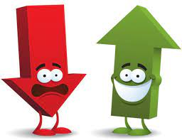
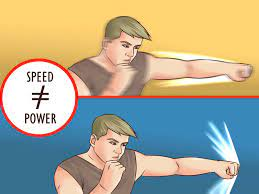
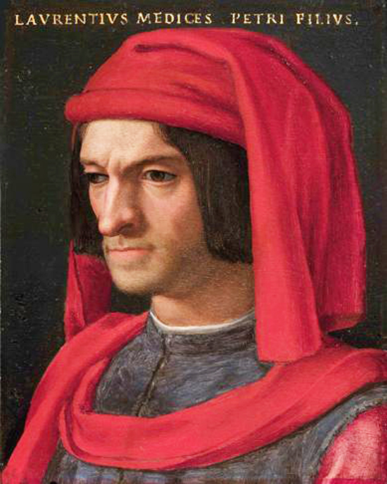

layout:false

background-image: url(assets/images/sna4ds_logo_140.png), url(assets/images/jads_logo_transparent.png), url(assets/images/network_people_7890_cropped2.png)
background-position: 100% 0%, 0% 10%, 0% 0%
background-size: 20%, 20%, cover
background-color: #000000

<br><br><br><br><br>
.full-width-screen-grey.center.fw9.font-250[
# .Orange-inline.f-shadows_into[`r rmarkdown::metadata$title`]
]

***

.full-width-screen-grey.center.fw9[.f-abel[.WhiteSmoke-inline[today's menu: ] .Orange-inline[`r rmarkdown::metadata$topic` .small-caps.font70[(lecture] .font70[`r rmarkdown::metadata$lecture_no`)]]]
  ]

<br>
.f-abel.White-inline[Your lecturer: `r rmarkdown::metadata$author`]<br>
.f-abel.White-inline[Playdate: `r rmarkdown::metadata$playdate`]


<!-- setup options start -->
```{r setup, include=FALSE}
knitr::opts_chunk$set(echo = FALSE,
                  comment = "",   # otherwise '##' is added in front of each output row
                  out.width = "90%",
                  fig.height = 6,
                  fig.path = "assets/images/",
                  fig.retina = 2,
                  dev = "svg",
                  message = FALSE,
                  warning = FALSE)
# library(htmlwidgets, quietly = TRUE, verbose = FALSE, warn.conflicts = FALSE)
# library(countdown, quietly = TRUE, verbose = FALSE, warn.conflicts = FALSE)

knitr::opts_knit$set(global.par = TRUE)  # anders worden de margin settings niet overal doorgevoerd

remedy::remedy_opts$set(name = paste0("stats_1", "_"))


edge_data <- c("a", "c", 
               "a", "d", 
               "a", "b", 
               "b", "c", 
               "b", "d", 
               "c", "e", 
               "d", "e", 
               "e", "f", 
               "f", "g", 
               "f", "h", 
               "g", "i", 
               "g", "j", 
               "h", "i", 
               "h", "j", 
               "i", "j")

el <- matrix(edge_data, ncol = 2, byrow = T)
net_igraph <- igraph::graph.edgelist(el, directed = F)
net_sna <- intergraph::asNetwork(net_igraph)
net_mat <- network::as.matrix.network.adjacency(net_sna)
net_mat[order(rownames(net_mat)), order(rownames(net_mat))]
diag(net_mat) <- 0
```


```{r marset, include = FALSE}
par(mar = c(0,0,0,0) + .05) #it's important to have this in a separate chunk
```


```{r xaringanExtra_settings, include = FALSE}
xaringanExtra::use_xaringan_extra(c("tile_view"
                                    , "panelset"
                                    , "animate"
                                    , "tachyons"
                                    , "freezeframe"
                                    , "broadcast"
                                    , "scribble"
                                    , "fit_screen"
                                    ))

xaringanExtra::use_webcam(50 * 3.5, 50 / 4 * 3 * 3.5)
xaringanExtra::use_editable(expires = 1)
xaringanExtra::use_search(show_icon = FALSE, case_sensitive = FALSE)
# xaringanExtra::use_clipboard()

htmltools::tagList(
  xaringanExtra::use_clipboard(
    button_text = "<i class=\"fa fa-clipboard\"></i>",
    success_text = "<i class=\"fa fa-check\" style=\"color: #90BE6D\"></i>",
    error_text = "<i class=\"fa fa-times-circle\" style=\"color: #F94144\"></i>"
  ),
  rmarkdown::html_dependency_font_awesome()
)
```


```{r xaringan-extra-styles, echo = FALSE}
xaringanExtra::use_extra_styles(
  hover_code_line = TRUE,         
  mute_unhighlighted_code = TRUE  
)
```

```{css echo=FALSE}
.highlight-last-item > ul > li, 
.highlight-last-item > ol > li {
  opacity: 0.5;
}

.highlight-last-item > ul > li:last-of-type,
.highlight-last-item > ol > li:last-of-type {
  opacity: 1;

.bold-last-item > ul > li:last-of-type,
.bold-last-item > ol > li:last-of-type {
  font-weight: bold;
}

.show-only-last-code-result pre + pre:not(:last-of-type) code[class="remark-code"] {
    display: none;
}
```

```{css}
.remark-inline-code {
  background: #F5F5F5;
  border-radius: 3px;
  padding: 4px;
}

.inverse-red, .inverse-red h1, .inverse-red h2, .inverse-red h3, .inverse-red a, inverse-red a > code {
	border-top: none;
	background-color: red;
	color: white; 
	background-image: "";
}

.inverse-orange, .inverse-orange h1, .inverse-orange h2, .inverse-orange h3, .inverse-orange a, inverse-orange a > code {
	border-top: none;
	background-color: orange;
	color: black; 
	background-image: "";
}
```


```{r some_handy_functions, echo = FALSE}
source("assets/R/components.R")
```


```{css}
.grid-3-1 {
  display: grid;
  height: calc(80%);
  grid-template-columns: repeat(3, 1fr);
  grid-template-rows: 1fr;
  align-items: center;
  text-align: center;
  grid-gap: 1em;
  padding: 1em;
}
```

<!-- setup options end -->

---
class: course-logo
layout: true

---
name: menu
description: List of contents for the lab
# Menu'
<br>
<br>
- ERGM terms bootcamp
- The Intensity of the Effects
- 7 steps Research Flow


---
<br>
<br>
<br>
<br>
<br>
<br>
<br>
# ERGM terms bootcamp
---
# Wooclap 
<br>

## The term test!

## MKRQLBY


---
```{css, echo=FALSE}
/* Keep prompts, counts and networks stationary between reveals. */
.term-count-slide .term-count {
  position: absolute;
  top: 205px;
  left: 60px;
  right: 60px;
  font-weight: bold;
}
.term-count-slide p:has(> img) {
  position: absolute;
  top: 250px;
  left: 60px;
  right: 60px;
  margin: 0;
  text-align: center;
}
.term-count-slide .term-note {
  position: absolute;
  bottom: 25px;
  left: 60px;
  right: 60px;
  font-size: 85%;
}
.term-value, .term-blank {
  display: inline-block;
  min-width: 2em;
}
.term-blank {
  border-bottom: 2px solid currentColor;
}
```

# Counting ERGM terms

Count each statistic, then check the highlighted answer.

All ties are directed. An **edge** is one arrow; a **dyad** is one unordered node pair.

```{r term-counting-setup, include=FALSE}
library(ergm)
n1 <- igraph::graph_from_edgelist(matrix(c('A','B','B','A','C','D','D','C',
  'A','C','B','E','D','E'), ncol=2, byrow=TRUE), directed=TRUE)
n2 <- igraph::graph_from_edgelist(matrix(c('A','B','A','C','B','C','A','D','B','D','C','D',
  'C','E','D','E','D','F','E','F','F','G','G','E'), ncol=2, byrow=TRUE), directed=TRUE)
n3 <- igraph::graph_from_edgelist(matrix(c('A','B','A','C','A','D','B','D',
  'C','D','D','E','C','E'), ncol=2, byrow=TRUE), directed=TRUE)
xy1 <- matrix(c(-1,1,0,1,-1,0,0,0,1,-.4), ncol=2, byrow=TRUE,
              dimnames=list(LETTERS[1:5],NULL))
xy2 <- matrix(c(-1.8,1.6,0,1.9,.6,.6,-1.2,.4,-.3,-1.1,1.8,-.9,.5,-2.3),
              ncol=2, byrow=TRUE, dimnames=list(LETTERS[1:7],NULL))
xy3 <- matrix(c(-1.5,.4,-.5,1,-.5,-.4,.5,.4,1.5,-.4),
              ncol=2, byrow=TRUE, dimnames=list(LETTERS[1:5],NULL))
pal <- c('#D55E00','#0072B2','#009E73','#CC79A7','#A6761D','#6A3D9A')
s1 <- summary(intergraph::asNetwork(n1) ~ edges + mutual + istar(2) + ostar(2))
s2 <- summary(intergraph::asNetwork(n2) ~ triangle + ctriple)
s3 <- summary(intergraph::asNetwork(n3) ~ esp(1, type='OTP') +
                esp(2, type='OTP') + gwesp(0.5, fixed=TRUE, type='OTP'))

# Separate lanes keep reciprocal arrows and overlapping stars visible.
plot_lanes <- function(g, xy, occurrences, vertex_colors=NULL) {
  ends <- igraph::as_edgelist(g)
  occurrences$key <- apply(ends[occurrences$edge,,drop=FALSE], 1,
    function(x) paste(sort(x), collapse=''))
  occurrences$offset <- 0
  for (key in unique(occurrences$key)) {
    ix <- which(occurrences$key==key)
    occurrences$offset[ix] <- if(length(ix)==1) 0 else seq(-.11,.11,length.out=length(ix))
  }
  par(mar=c(0,0,0,0))
  plot(NA, xlim=range(xy[,1])+c(-.5,.5), ylim=range(xy[,2])+c(-.5,.5),
       asp=1, axes=FALSE, xlab='', ylab='')
  for (k in seq_len(nrow(occurrences))) {
    z <- occurrences[k,]; a <- xy[ends[z$edge,1],]; b <- xy[ends[z$edge,2],]
    d <- (b-a)/sqrt(sum((b-a)^2)); p <- c(-d[2],d[1])
    if (ends[z$edge,1]>ends[z$edge,2]) p <- -p
    start <- a+.20*d+z$offset*p; finish <- b-.20*d+z$offset*p
    arrows(start[1],start[2],finish[1],finish[2],length=.12,
           lwd=if(z$star==0) 2 else if(z$star==2) 5 else 3.5,col=z$color)
  }
  symbols(xy[,1],xy[,2],circles=rep(.16,nrow(xy)),inches=FALSE,
          add=TRUE,bg=if(is.null(vertex_colors)) 'white' else vertex_colors[rownames(xy)],
          fg='#444444',lwd=2)
  text(xy[,1],xy[,2],rownames(xy),font=2,cex=1.4,
       col=if(is.null(vertex_colors)) 'black' else ifelse(vertex_colors[rownames(xy)]==pal[2],'white','black'))
}
plain <- function(g,xy) {
  plot_lanes(g,xy,data.frame(edge=seq_len(igraph::ecount(g)),color='#999999',star=0L))
}
highlight <- function(g,xy,colors) {
  plot_lanes(g,xy,data.frame(edge=seq_len(igraph::ecount(g)),color=colors,
                            star=as.integer(colors!='#999999')))
}
plot_stars <- function(mode) {
  ends <- igraph::as_edgelist(n1); motifs <- list()
  for (v in igraph::V(n1)$name) {
    hits <- which(if(mode=='out') ends[,1]==v else ends[,2]==v)
    if(length(hits)>=2) for(pair in combn(hits,2,simplify=FALSE)) {
      motifs[[length(motifs)+1L]] <- pair
    }
  }
  occurrence <- do.call(rbind,lapply(seq_along(motifs),function(i)
    data.frame(edge=motifs[[i]],color=pal[i],star=i)))
  extras <- setdiff(seq_len(igraph::ecount(n1)),occurrence$edge)
  if(length(extras)) occurrence <- rbind(occurrence,
    data.frame(edge=extras,color='#999999',star=0L))
  plot_lanes(n1,xy1,occurrence)
}
trace_esp <- function(target, paths, partners, color) {
  e <- igraph::as_edgelist(n3); names <- paste(e[,1],e[,2],sep='->')
  cols <- ifelse(names%in%c(target,paths),color,'#999999')
  nodes <- setNames(rep('white',igraph::vcount(n3)),igraph::V(n3)$name)
  nodes[partners] <- color
  plot_lanes(n3,xy3,data.frame(edge=seq_len(igraph::ecount(n3)),color=cols,
    star=ifelse(names==target,2L,as.integer(cols!='#999999'))),nodes)
}
# Apply plot dimensions only to this exercise's chunks.
knitr::opts_hooks$set(term_plot=function(options) {
  if (isTRUE(options$term_plot)) {
    options$fig.width <- 9
    options$fig.height <- 4
    options$out.width <- '68%'
  }
  options
})
```

---
class: term-count-slide
# Edges: count

How many arrows? Count both directions of a reciprocal pair.

.term-count[`edges` = <span class="term-blank">&nbsp;</span>]

```{r terms-edges-question, term_plot=TRUE}
plain(n1,xy1)
```

---
class: term-count-slide
# Edges: answer

Each arrow counts once.

.term-count[`edges` = <span class="term-value">`r s1['edges']`</span>]

```{r terms-edges-answer, term_plot=TRUE}
highlight(n1,xy1,rep(pal[2],igraph::ecount(n1)))
```

---
class: term-count-slide
# Mutual dyads: count

How many pairs have arrows in both directions? Name them.

.term-count[`mutual` = <span class="term-blank">&nbsp;</span>]

```{r terms-mutual-question, term_plot=TRUE}
plain(n1,xy1)
```

---
class: term-count-slide
# Mutual dyads: answer

A–B and C–D. Each pair counts once.

.term-count[`mutual` = <span class="term-value">`r s1['mutual']`</span>]

```{r terms-mutual-answer, term_plot=TRUE}
e <- igraph::as_edgelist(n1)
cols <- ifelse(e[,1]%in%c('A','B') & e[,2]%in%c('A','B'),pal[1],
        ifelse(e[,1]%in%c('C','D') & e[,2]%in%c('C','D'),pal[2],'#999999'))
highlight(n1,xy1,cols)
```

---
class: term-count-slide
# Two-out-stars: count

A **2-out-star** is two arrows with the same sender. Count the stars and identify their arrows.

.term-count[`ostar(2)` = <span class="term-blank">&nbsp;</span>]

<div class="term-note">Outdegree \(d\) contributes \(\binom{d}{2}\) stars.</div>

```{r terms-out-question, term_plot=TRUE}
plain(n1,xy1)
```

---
class: term-count-slide
# Two-out-stars: answer

A, B and D each contribute one star.

.term-count[`ostar(2)` = <span class="term-value">`r s1['ostar2']`</span>]

```{r terms-out-answer, term_plot=TRUE}
plot_stars('out')
```

.term-note[A→B / A→C; B→A / B→E; D→C / D→E. Each color marks one star.]

---
class: term-count-slide
# Two-in-stars: count

A **2-in-star** is two arrows with the same receiver. Count the stars and identify their arrows.

.term-count[`istar(2)` = <span class="term-blank">&nbsp;</span>]

<div class="term-note">Indegree \(d\) contributes \(\binom{d}{2}\) stars.</div>

```{r terms-in-question, term_plot=TRUE}
plain(n1,xy1)
```

---
class: term-count-slide
# Two-in-stars: answer

C receives from A and D; E receives from B and D.

.term-count[`istar(2)` = <span class="term-value">`r s1['istar2']`</span>]

```{r terms-in-answer, term_plot=TRUE}
plot_stars('in')
```

.term-note[Each color marks one star; grey arrows belong to none.]

---
class: term-count-slide
# Closed triads: count

No reciprocal ties. List triples with all three pairs connected (`triangle`); identify directed cycles (`ctriple`).

.term-count[`triangle` = <span class="term-blank">&nbsp;</span> · `ctriple` = <span class="term-blank">&nbsp;</span>]

```{r terms-tri-question, term_plot=TRUE}
plain(n2,xy2)
```

---
class: term-count-slide
# Closed triads: answer

Orange: transitive ABC. Purple: cyclic EFG.

.term-count[`triangle` = <span class="term-value">`r s2['triangle']`</span> · `ctriple` = <span class="term-value">`r s2['ctriple']`</span>]

```{r terms-tri-answer, term_plot=TRUE}
e <- igraph::as_edgelist(n2)
cols <- ifelse(e[,1]%in%c('A','B','C') & e[,2]%in%c('A','B','C'),pal[1],
        ifelse(e[,1]%in%c('E','F','G') & e[,2]%in%c('E','F','G'),pal[4],'#999999'))
highlight(n2,xy2,cols)
```

.term-note[Transitive: ABC, ABD, ACD, BCD, CDE, DEF. Cyclic: EFG.]

---
class: term-count-slide
# Edgewise shared partners: count

For **OTP**, a shared partner of $i\to j$ is a node $k$ on $i\to k\to j$. Which arrows have one partner? Two?

.term-count[`esp(1)` = <span class="term-blank">&nbsp;</span> · `esp(2)` = <span class="term-blank">&nbsp;</span>]

.term-note[`esp(d, type="OTP")` counts arrows with exactly $d$ outgoing two-path shared partners.]

```{r terms-esp-question, term_plot=TRUE}
plain(n3,xy3)
```

---
class: term-count-slide
# One shared partner: answer

C→E has one partner: D, via C→D→E.

.term-count[`esp(1)` = <span class="term-value">`r s3['esp.OTP1']`</span> · `esp(2)` = <span class="term-blank">&nbsp;</span>]

```{r terms-esp-one, term_plot=TRUE}
trace_esp('C->E',c('C->D','D->E'),'D',pal[1])
```

.term-note[The thick arrow is counted; the other colored arrows show the two-path.]

---
class: term-count-slide
# Two shared partners: answer

A→D has two partners: B and C.

.term-count[`esp(1)` = <span class="term-value">`r s3['esp.OTP1']`</span> · `esp(2)` = <span class="term-value">`r s3['esp.OTP2']`</span>]

```{r terms-esp-two, term_plot=TRUE}
trace_esp('A->D',c('A->B','B->D','A->C','C->D'),c('B','C'),pal[2])
```

.term-note[A→B→D and A→C→D. The target arrow contributes **one** to `esp(2)`, not two.]

---
# From ESP to GWESP

With decay $0.5$, an arrow with $k$ OTP shared partners contributes

$$
w(k)=e^{0.5}\left[1-\left(1-e^{-0.5}\right)^k\right].
$$

| Arrow | Partners | ESP statistic | GWESP contribution |
|:--|:--|:--|:--|
| C→E | D | `esp(1) = 1` | $w(1)=1$ |
| A→D | B, C | `esp(2) = 1` | $w(2)=2-e^{-0.5}\approx1.393$ |

**`gwesp(0.5, fixed=TRUE, type="OTP")` = `r sprintf('%.3f',s3['gwesp.OTP.fixed.0.5'])`**.

The first partner adds 1; the second adds about 0.393. GWESP combines ESP counts with diminishing contributions from additional partners.

---
# Counts and coefficients

These counts are the ERGM's sufficient statistics $g(y)$:

- **Network 1:** `edges` = `r s1['edges']`, `mutual` = `r s1['mutual']`, `ostar(2)` = `r s1['ostar2']`, `istar(2)` = `r s1['istar2']`.
- **Network 2:** `triangle` = `r s2['triangle']`, `ctriple` = `r s2['ctriple']`.
- **Network 3:** `esp(1)` = `r s3['esp.OTP1']`, `esp(2)` = `r s3['esp.OTP2']`, `gwesp(0.5)` = `r sprintf('%.3f',s3['gwesp.OTP.fixed.0.5'])`.

Coefficients weight these statistics in the model. Toggling one arrow can change several statistics at once.

---
name: estimation_tricks
# Estimation tricks: checkpointing

```{r checkpoint_render_setup, include=FALSE}
set.seed(2026)
# Never overwrite or delete an existing user checkpoint just to render the demo.
if (file.exists("ergm-checkpoint.RData"))
  stop("Existing ergm-checkpoint.RData preserved. Move it aside before rendering this demo.")
network <- intergraph::asNetwork(n1)
network::set.vertex.attribute(network, "group", c("one", "one", "two", "two", "two"))
```

.pull-left-1[
**Five nodes, seven directed ties.**

```{r checkpoint_network, echo=FALSE, fig.width=3.5, fig.height=3, out.width="95%"}
checkpoint_colors <- setNames(
  ifelse(network::get.vertex.attribute(network, "group") == "one", pal[1], pal[2]),
  network::get.vertex.attribute(network, "vertex.names"))
plot_lanes(n1, xy1,
  data.frame(edge=seq_len(igraph::ecount(n1)), color="#777777", star=0L),
  vertex_colors=checkpoint_colors)
```

**Orange:** group one (A/B).<br>
**Blue:** group two (C/D/E).
]

.pull-right-2[
**Overwritten at the start of each MCMLE iteration.**

```{r checkpoint_fit, echo=TRUE, eval=FALSE}
checkpoint_file <- "ergm-checkpoint.RData"

fit <- ergm::ergm(
  network ~ edges + mutual + nodematch("group"),
  control = ergm::control.ergm(
    MCMC.samplesize = 500,
    MCMC.burnin = 100,
    MCMLE.maxit = 5,
    parallel = 0,
    parallel.type = "PSOCK",
    checkpoint = checkpoint_file,
    resume = if (file.exists(checkpoint_file)) checkpoint_file else NULL
  )
)
```

```{r checkpoint_first_output, echo=FALSE}
checkpoint_log <- character()
withCallingHandlers(
  eval(parse(text = knitr::knit_code$get("checkpoint_fit"))),
  message = function(m) {
    checkpoint_log <<- c(checkpoint_log, conditionMessage(m))
    invokeRestart("muffleMessage")
  }
)
cat(grep("^(Iteration |Saving state)", checkpoint_log, value = TRUE), sep = "")
```
]

???
The output chunks run the displayed code and print the save/resume messages.
The network is n1: A/B belong to group one; C/D/E belong to group two.
The controls follow the lecture, with smaller samples, burn-in, and maxit.
parallel=0 runs in the current R process; PSOCK applies when workers are enabled.
The first fit finishes normally. The second run reloads its checkpoint;
no crash is simulated.

---
name: checkpoint_resume
# Estimation tricks: resuming a fit

If RStudio crashes or you stop the fit, rerun the whole code block.
The fit resumes from the last checkpoint.

**Output after rerunning:**

```{r checkpoint_resume_output, echo=FALSE}
checkpoint_log <- character()
withCallingHandlers(
  eval(parse(text = knitr::knit_code$get("checkpoint_fit"))),
  message = function(m) {
    checkpoint_log <<- c(checkpoint_log, conditionMessage(m))
    invokeRestart("muffleMessage")
  }
)
cat(grep("^(Resuming from|Iteration |Saving state)", checkpoint_log, value = TRUE), sep = "")
```

The counter restarts at 1, but the fit uses the saved state.
Use the same network and model.

To start again, delete the checkpoint:

```{r checkpoint_reset, echo=TRUE}
file.remove("ergm-checkpoint.RData")
```

???
ergm 4.12.0 restarts the iteration counter when resuming.
The checkpoint stores the state at the start of an MCMLE iteration.
Work after the last save must be repeated. The file is not the final fitted model.
A fixed filename causes "one argument not used by format" sprintf warnings in
this version; the deck's warning=FALSE hides them.
file.remove deletes the checkpoint created for this example.


---
<br>
<br>
<br>
<br>
<br>
<br>
<br>
# The Intensity of the Effects

---
name: Model_results
description: Interpreting model results
# Interpreting model results
<br>
<br>
<br>

1. $\theta$ > 0 and stat. signif. -> X increases P(1) and decreases P(0)
2. $\theta$ < 0 and stat. signif. -> X decreases P(1) and increases P(0)
3. $\theta$ not stat. signif. -> X does not affect P(1) and P(0)

---
# Binary 

## The sign of $\theta$ provides us with a binary interpretation:

### the probability of the edge forming
- Increases 
- Decreases

.center[]

---
# Ok, sure... How much!?

<br>
The number tells us "how much'' ---- Intensity

.center[]


---
# How much ... or "The extent to which..."

<br>
## x predicts y
<br>

- The odds that x predicts (y) edge formation
- The probability that x predicts (y) edge formation

---
name: Odds_ratios
description: Odds_ratios
# Odds ratios (Memo: Bootcamp!)

<br>

### ERGMs work with log scale, right? 

### Well, to interpret our coefficients we need to exponentiate it. Makes sense, doesn't it?

<br>

### When you exponentiate you estimate the odds of something to happen -- 

 .red[ODDS = probability of success]
 
### FORMULA

$OR = exp(\theta)$

---
# Odds Ratios meaning (Memo: Bootcamp!)

<br>

### If the coefficients are statistically significant it is possible to comment on the odds of the effect taking place

<br>
## Interpretation:

### An increase of 1 in $X_1$ increases the log odds with $\theta_1$ (log odds) and it makes the odds of the effect taking place $exp(\theta_1)$ times larger.

---
# Consider that...
<br>
<br>
## Odds Ratio is a measure of the strength of association with an exposure and an outcome.

<br>

1. OR > 1 means greater odds of association with the exposure and outcome.
2. OR = 1 means there is no association between exposure and outcome.
3. OR < 1 means there is a lower odds of association between the exposure and outcome.
---
name: Probabilities
description: Probabilities
# Probabilities
<br>
<br>
It measures the probability of an effect taking place
<br>
FORMULA:

$P = \frac{exp(\theta)}{1 + exp(\theta)}$

<br>

WARNING: if you want to use % the result needs to be multiplied by 100.

---
name: example_inter_res
description: Example for interpreting results
# Back to Florence

## Let's see the intensity of some effects

```{r lab11_01, echo = FALSE}
flo <-SNA4DSData::florentine
fflom <- flo$flomarriage
flom <- intergraph::asNetwork(fflom)
```

.center[]
---
# Dyadic independent model


```{r lab11_02, echo = TRUE}

m <- ergm::ergm(flom ~ edges + nodecov("Wealth"))

```

.center[]
---
# Coefficients 
$\theta$


```{r lab11_03, echo = TRUE}
summary(m)
```
---
# Coefficient interpretation
<br>
### Edges -2.595
$\theta$ < 0 and stat. signif. -> X decreases P(1) and increases P(0)

<br>
### Wealth 0.011

$\theta$ > 0 and stat. signif. -> X increases P(1) and decreases P(0)

<br>

## We still don't know anything about the intensity!!!
---
# Odds Ratios 

$exp(\theta)$


```{r lab11_04, echo = TRUE}
snafun::stat_ef_int(m, type = "odds")
```

### manually estimating edges odds ratios
```{r lab11_05, echo = TRUE}
exp(-2.594929)
```
---
# Odds Interpretation

### edges   0.075

An increase of 1 in .red[the number of edges] increases the log odds with $-2.595$ and it makes the odds of the effect taking place $0.075$ times larger.

OR < 1 means that the odds of forming edges in this network is small.

### nodecov.Wealth 0.011

An increase of 1 in .red[wealth] increases the log odds with $0.011$ and it makes the odds of the effect taking place $1.011$ times larger.

OR > 1 means that the odds of wealth influencing marriage are bigger

OR = 1 means there is little association between wealth influencing marriage.
---
# Probabilities 

$exp(\theta)/ (1 + exp(\theta))$

<br>
```{r lab11_06, echo = TRUE}
snafun::stat_ef_int(m, type = "prob")
```


## manually estimating edges probabilities
```{r lab11_08, echo = TRUE}

exp(-2.594929)/ (1 + exp(-2.594929))

```

---
# Probabilities Interpretation


```{r lab11_07, echo = TRUE}

0.069 * 100
0.503 * 100
```
<br>
### 6.9 % prob of forming edges

small prob, so it is consistent with the OR result
<br>
### 50.3 % prob that wealth predicts marriage

it's a bit more than 1/2 so it is consistent with the OR result


---
<br>
<br>
<br>
<br>
<br>
<br>
<br>
# 7 steps Research Flow

---
name: Research_flow
description: Approach to carry out research
# Let's organize our research in steps
<br>
1. Literature research/ Questions & Hypotheses (based on the literature) [- data collection]
2. Data Exploration + terms selection
3. Running models (baseline, exploratory models, final model)
4. MCMC diagnostics of the best selected model
5. Goodness of fit
6. Interpreting results
7. Write up about your research telling how this journey went

<br> 

.red[TIP: Rely on these steps for your report]

---
# See you on Next Week!

<br>

.center[]


